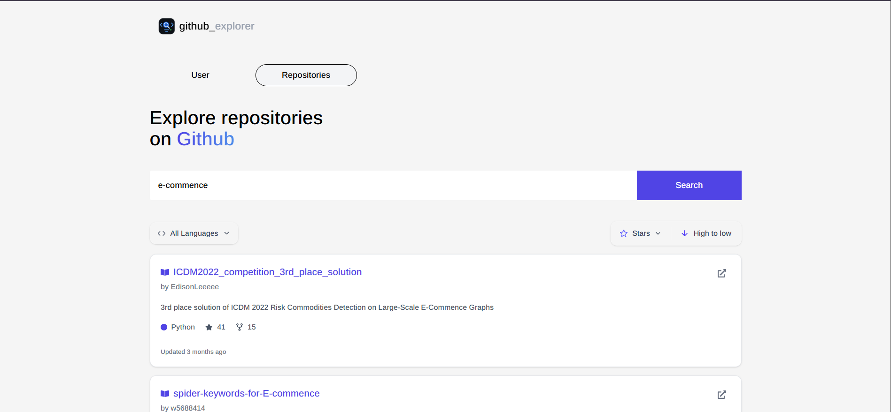

# GitHub Explorer

GitHub Explorer is a web application that allows users to search for GitHub profiles and explore repositories. It helps users discover similar projects for inspiration and reference when planning their own projects.

## Demo

**Live Demo:** https://github-explorer-six-delta.vercel.app



## Features

- **GitHub Profile Search** — Search for GitHub users by username and view their profile information.
- **Repository Search** — Search for GitHub repositories and explore project details.
- **Pagination** — Navigate through repository search results page by page.
- **Repository Sorting** — Sort repositories by stars and forks in ascending or descending order.
- **Language Filtering** — Filter repositories by programming language.
- **Loading and Error Handling** — Display loading states and handle API errors during searches.

## Tech Stack

- **React** — Build the user interface with reusable components.
- **Vite** — Development server and build tool.
- **JavaScript** — Application logic and functionality.
- **Tailwind CSS** — Styling and responsive UI.
- **GitHub REST API** — Retrieve GitHub user and repository data.
- **React Hot Toast** — Display notifications.

## Getting Started

Follow these steps to run GitHub Explorer locally.

### Prerequisites

Make sure you have the following installed:

- [Node.js](https://nodejs.org/)
- npm or pnpm

### Installation

1. Clone the repository:

   ```bash
   git clone https://github.com/myo-thant-naing/github-explorer.git
   ```

2. Navigate to the project directory:

   ```bash
   cd github-explorer
   ```

3. Install dependencies using your package manager.

   With npm:

   ```bash
   npm install
   ```

   Or with pnpm:

   ```bash
   pnpm install
   ```

4. Start the development server.

   With npm:

   ```bash
   npm run dev
   ```

   Or with pnpm:

   ```bash
   pnpm dev
   ```

5. Open the local URL displayed in your terminal.

## Usage

1. Open GitHub Explorer in your browser.
2. Choose profile search or repository search.
3. Enter a GitHub username or repository search query.
4. Explore the search results.
5. Use pagination, sorting, and language filtering to find relevant repositories.

## Project Structure

The project is organized into reusable React components and supporting modules.

- `src/` — Main application source code.
- `src/components/` — Reusable UI components.
- `src/api/` — GitHub API request logic.

*Adjust these paths if your actual project structure differs.*

## Learning Goals

This project provides practical experience with:

- Building reusable React components.
- Managing state and handling user interactions.
- Fetching data from an external REST API.
- Handling loading states and API errors.
- Filtering, sorting, and paginating data.
- Organizing code into maintainable modules.
